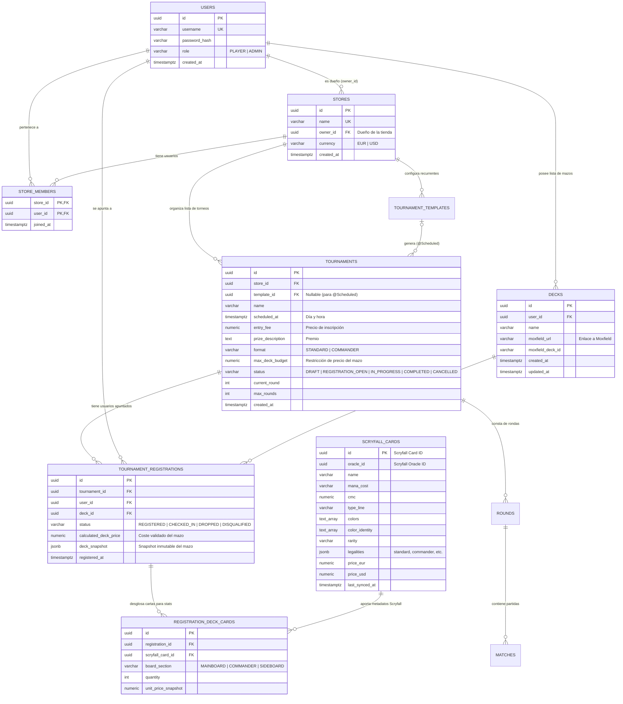

# Data Model: Tienda, Usuarios, Torneos, Mazos (Moxfield) y Cartas (Scryfall)

**Feature**: `001-store-tournament-data-model`  
**Database Engine**: PostgreSQL 15+ (Supabase / Neon)  
**Migration Tool**: Flyway (`src/main/resources/db/migration`)

---

## 1. Diagrama Entidad-Relación (ER)



---

## 2. Especificación de Entidades y Tablas

### 2.1. `users` (Usuario)
Representa a cualquier persona registrada en el sistema, distinguiendo entre el jugador estándar y el **Dueño** de tienda.

| Columna | Tipo PostgreSQL | Restricciones | Descripción |
| :--- | :--- | :--- | :--- |
| `id` | `UUID` | `PRIMARY KEY DEFAULT gen_random_uuid()` | Identificador único del usuario. |
| `username` | `VARCHAR(60)` | `NOT NULL UNIQUE` | Nombre único del usuario. |
| `password_hash` | `VARCHAR(255)` | `NOT NULL` | Contraseña cifrada con BCrypt. |
| `role` | `VARCHAR(20)` | `NOT NULL CHECK (role IN ('PLAYER', 'ADMIN'))` | `ADMIN` representa al usuario Dueño con permisos elevados. |
| `created_at` | `TIMESTAMPTZ` | `NOT NULL DEFAULT now()` | Fecha de alta. |

### 2.2. `stores` (Tienda) y `store_members` (Usuarios de la Tienda)
Representa la tienda física u organizadora, su **propietario** (`owner_id`), su **lista de usuarios** (`store_members`) y su **lista de torneos** (`tournaments.store_id`).

| Tabla | Columna | Tipo PostgreSQL | Restricciones | Descripción |
| :--- | :--- | :--- | :--- | :--- |
| `stores` | `id` | `UUID` | `PRIMARY KEY DEFAULT gen_random_uuid()` | Identificador de la tienda. |
| `stores` | `name` | `VARCHAR(120)` | `NOT NULL UNIQUE` | Nombre comercial de la tienda. |
| `stores` | `owner_id` | `UUID` | `NOT NULL REFERENCES users(id)` | Usuario **Dueño/Propietario** de la tienda. |
| `stores` | `currency` | `VARCHAR(3)` | `NOT NULL DEFAULT 'EUR'` | Moneda para precios y restricciones (`EUR` / `USD`). |
| `store_members` | `store_id` | `UUID` | `NOT NULL REFERENCES stores(id) ON DELETE CASCADE` | Tienda a la que pertenece el usuario. |
| `store_members` | `user_id` | `UUID` | `NOT NULL REFERENCES users(id) ON DELETE CASCADE` | Usuario miembro de la tienda (`PRIMARY KEY (store_id, user_id)`). |
| `store_members` | `joined_at` | `TIMESTAMPTZ` | `NOT NULL DEFAULT now()` | Fecha de vinculación a la tienda. |

### 2.3. `decks` (Mazo del Usuario)
El mazo perteneciente a la lista de mazos de un usuario consiste esencialmente en su enlace a **Moxfield**.

| Columna | Tipo PostgreSQL | Restricciones | Descripción |
| :--- | :--- | :--- | :--- |
| `id` | `UUID` | `PRIMARY KEY DEFAULT gen_random_uuid()` | Identificador interno del mazo. |
| `user_id` | `UUID` | `NOT NULL REFERENCES users(id) ON DELETE CASCADE` | Propietario del mazo (lista de mazos del usuario). |
| `name` | `VARCHAR(150)` | `NOT NULL` | Nombre descriptivo (obtenido de Moxfield o indicado por el usuario). |
| `moxfield_url` | `VARCHAR(500)` | `NOT NULL` | Enlace completo al mazo en Moxfield (`https://www.moxfield.com/decks/...`). |
| `moxfield_deck_id` | `VARCHAR(64)` | `NOT NULL` | ID público extraído del enlace de Moxfield para consumo vía `MoxfieldClient`. |
| `created_at` | `TIMESTAMPTZ` | `NOT NULL DEFAULT now()` | Fecha de registro del enlace. |

### 2.4. `tournaments` (Torneo) y `tournament_templates` (Plantillas `@Scheduled`)
Almacena los torneos de una tienda con su día y hora, precio de entrada, premio y restricciones (formato *Standard* o *Commander* y tope de precio del mazo).

| Columna | Tipo PostgreSQL | Restricciones | Descripción |
| :--- | :--- | :--- | :--- |
| `id` | `UUID` | `PRIMARY KEY DEFAULT gen_random_uuid()` | Identificador del torneo. |
| `store_id` | `UUID` | `NOT NULL REFERENCES stores(id) ON DELETE CASCADE` | Tienda organizadora. |
| `template_id` | `UUID` | `NULL REFERENCES tournament_templates(id)` | Plantilla origen si fue creado por `@Scheduled`. |
| `name` | `VARCHAR(150)` | `NOT NULL` | Título del torneo. |
| `scheduled_at` | `TIMESTAMPTZ` | `NOT NULL` | **Día y hora** de inicio del torneo. |
| `entry_fee` | `NUMERIC(10,2)` | `NOT NULL CHECK (entry_fee >= 0)` | **Precio** de inscripción al torneo. |
| `prize_description` | `TEXT` | `NOT NULL` | **Premio** o estructura de premios del torneo. |
| `format` | `VARCHAR(30)` | `NOT NULL CHECK (format IN ('STANDARD', 'COMMANDER'))` | **Restricción de formato** de Magic (*Standard*, *Commander*). |
| `max_deck_budget` | `NUMERIC(10,2)` | `NOT NULL CHECK (max_deck_budget > 0)` | **Restricción de precio** máximo permitido para el mazo. |
| `status` | `VARCHAR(30)` | `NOT NULL` | `DRAFT`, `REGISTRATION_OPEN`, `IN_PROGRESS`, `COMPLETED`, `CANCELLED`. |
| `current_round` | `INT` | `NOT NULL DEFAULT 0` | Ronda actual en curso. |
| `max_rounds` | `INT` | `NOT NULL DEFAULT 3` | Número total de rondas suizas previstas. |

> **Regla de Idempotencia (`@Scheduled`)**: `UNIQUE (template_id, scheduled_at)` impide que `TournamentAutoScheduler` duplique un torneo recurrente para la misma fecha/hora.

### 2.5. `tournament_registrations` (Lista de Usuarios Apuntados y Snapshot JSONB)
Representa la lista de usuarios apuntados a cada torneo junto con la instantánea inmutable de su mazo validado.

| Columna | Tipo PostgreSQL | Restricciones | Descripción |
| :--- | :--- | :--- | :--- |
| `id` | `UUID` | `PRIMARY KEY DEFAULT gen_random_uuid()` | Identificador de la inscripción. |
| `tournament_id` | `UUID` | `NOT NULL REFERENCES tournaments(id) ON DELETE CASCADE` | Torneo al que se apunta el jugador. |
| `user_id` | `UUID` | `NOT NULL REFERENCES users(id) ON DELETE CASCADE` | Usuario apuntado (`UNIQUE (tournament_id, user_id)`). |
| `deck_id` | `UUID` | `NOT NULL REFERENCES decks(id)` | Mazo de Moxfield seleccionado por el jugador. |
| `status` | `VARCHAR(25)` | `NOT NULL` | `REGISTERED`, `CHECKED_IN`, `DROPPED`, `DISQUALIFIED`. |
| `calculated_deck_price` | `NUMERIC(10,2)` | `NOT NULL CHECK (calculated_deck_price >= 0)` | Suma total del coste del mazo calculada con datos de Scryfall. |
| `deck_snapshot` | `JSONB` | `NOT NULL` | Snapshot inmutable del mazo en el instante de la inscripción. |
| `registered_at` | `TIMESTAMPTZ` | `NOT NULL DEFAULT now()` | Fecha y hora de inscripción. |

#### Estructura del Documento `deck_snapshot` (`JSONB`):
```json
{
  "moxfieldDeckId": "AbC123XyZ",
  "moxfieldUrl": "https://www.moxfield.com/decks/AbC123XyZ",
  "deckName": "Azorius Control Budget",
  "format": "STANDARD",
  "totalPrice": 74.50,
  "currency": "EUR",
  "capturedAt": "2026-11-01T15:30:00Z",
  "commanders": [],
  "mainboard": [
    {
      "scryfallId": "f295b713-1d6a-43fd-910d-fb35414bf58a",
      "oracleId": "00010d56-2f5a-4698-9c53-0b7a5a7f82d2",
      "name": "Counterspell",
      "quantity": 4,
      "manaCost": "{U}{U}",
      "cmc": 2.0,
      "typeLine": "Instant",
      "colors": ["U"],
      "rarity": "uncommon",
      "unitPrice": 1.25
    }
  ],
  "sideboard": []
}
```

### 2.6. `scryfall_cards` y `registration_deck_cards` (Información de Scryfall y Estadísticas)
Conserva la información oficial aportada por **Scryfall** sobre las cartas y su desglose por inscripción para alimentar `AnalyticsController` y `BudgetValidator`.

| Tabla | Columna | Tipo PostgreSQL | Descripción |
| :--- | :--- | :--- | :--- |
| `scryfall_cards` | `id` | `UUID PRIMARY KEY` | ID único de impresión en Scryfall. |
| `scryfall_cards` | `oracle_id` | `UUID NOT NULL` | ID de reglas unificado de la carta en Scryfall (para agrupar distintas ediciones de la misma carta en estadísticas). |
| `scryfall_cards` | `name` | `VARCHAR(200) NOT NULL` | Nombre oficial de la carta. |
| `scryfall_cards` | `mana_cost` | `VARCHAR(60)` | Coste de maná simbólico (ej. `{2}{W}{U}`). |
| `scryfall_cards` | `cmc` | `NUMERIC(5,2) NOT NULL` | Valor de maná (Mana Value / CMC) para curvas de maná. |
| `scryfall_cards` | `type_line` | `VARCHAR(200) NOT NULL` | Línea de tipo (ej. `Legendary Creature — Human Wizard`). |
| `scryfall_cards` | `colors` | `TEXT[] NOT NULL` | Array de colores (`W`, `U`, `B`, `R`, `G`). |
| `scryfall_cards` | `color_identity` | `TEXT[] NOT NULL` | Identidad de color (clave para validar *Commander*). |
| `scryfall_cards` | `rarity` | `VARCHAR(20) NOT NULL` | `common`, `uncommon`, `rare`, `mythic`. |
| `scryfall_cards` | `legalities` | `JSONB NOT NULL` | Mapa de legalidad de Scryfall (`{"standard": "legal", "commander": "legal"}`). |
| `scryfall_cards` | `price_eur` / `price_usd` | `NUMERIC(10,2)` | Precio unitario reportado por Scryfall (`prices.eur` / `prices.usd`). |
| `registration_deck_cards` | `registration_id` | `UUID FK` | Referencia a `tournament_registrations(id)`. |
| `registration_deck_cards` | `scryfall_card_id` | `UUID FK` | Referencia a `scryfall_cards(id)`. |
| `registration_deck_cards` | `board_section` | `VARCHAR(20)` | `COMMANDER`, `MAINBOARD`, `SIDEBOARD`. |
| `registration_deck_cards` | `quantity` | `INT NOT NULL` | Número de copias en el mazo inscrito. |
| `registration_deck_cards` | `unit_price_snapshot` | `NUMERIC(10,2)` | Precio unitario aplicado en el momento de la inscripción. |

---

## 3. Reglas de Validación de Dominio Derivadas del Modelo

1. **Validación de Formato (`STANDARD` / `COMMANDER`)**:
   - Para cada carta del mazo obtenido desde `moxfield_url`, se consulta `scryfall_cards.legalities->>lower(tournament.format)` y debe ser igual a `'legal'`.
   - En formato `COMMANDER`, el tamaño total del mazo debe ser 100 cartas exactas (1 comandante + 99 cartas singulares salvo tierras básicas) y la `color_identity` de cada carta debe ser subconjunto de la `color_identity` del comandante.
   - En formato `STANDARD`, el `mainboard` debe tener al menos 60 cartas, el `sideboard` máximo 15 cartas y máximo 4 copias por `oracle_id` (salvo tierras básicas).
2. **Validación de Presupuesto (`BudgetValidator`)**:
   - `calculated_deck_price = SUM(quantity * unit_price_snapshot)`.
   - Si `calculated_deck_price > tournament.max_deck_budget`, la inscripción es rechazada antes de persistir en `tournament_registrations`.
3. **Autorización de Propietario de Tienda**:
   - Solo un usuario con `role = 'ADMIN'` y cuyo `user.id == store.owner_id` puede crear/modificar torneos o gestionar miembros de esa tienda.

