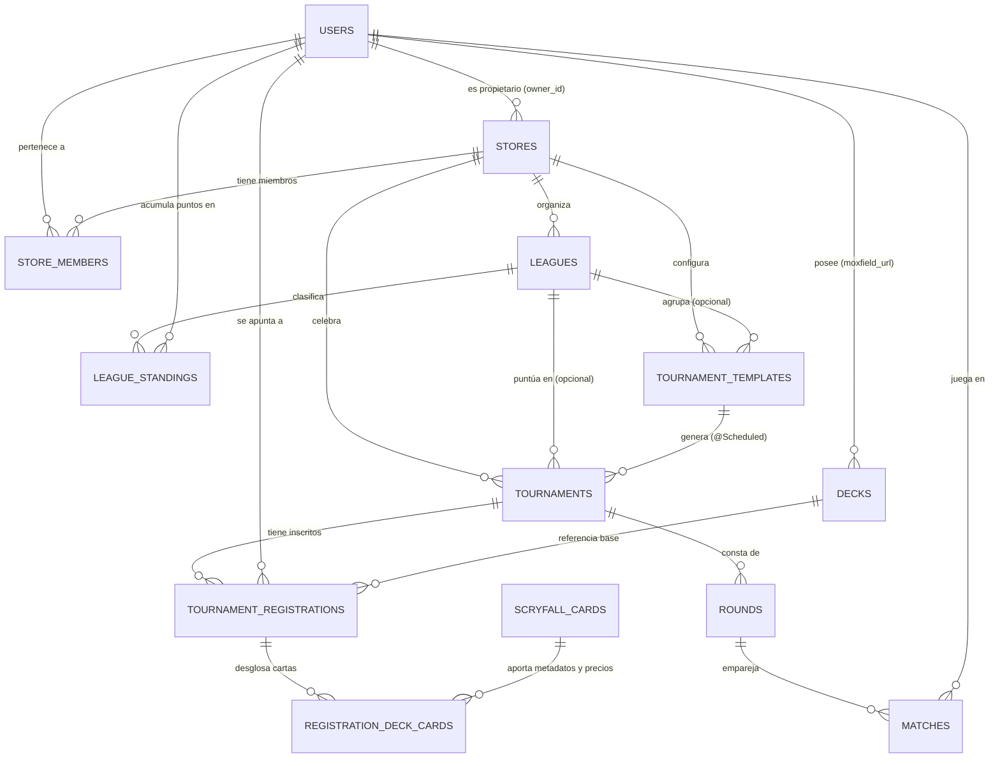

# Data Model: Acceso a Datos de Torneos, Ligas y Estadísticas de Tienda e Integración con Scryfall (`002-store-tournament-backend-scryfall`)

## 1. Diagrama Entidad-Relación (12 Tablas + 2 Vistas SQL)



---

## 2. Entidades del Modelo de Datos y Reglas de Validación

### 2.1. `User` (`users`)
- **Campos**:
  - `id` (`UUID`, PK)
  - `username` (`String`, max 60, `UNIQUE`, `NOT NULL`)
  - `passwordHash` (`String`, max 255, `NOT NULL` — **nunca expuesto en proyecciones de lectura pública/perfil**)
  - `role` (`UserRole`: `PLAYER` | `ADMIN`, `NOT NULL`)
  - `createdAt` (`Instant`, `NOT NULL`)
- **Agregaciones requeridas por `002-backend-dtos` (`UserProfile`)**:
  - Lista de tiendas a las que pertenece (`store_members`), recuento total de mazos registrados (`decks`) y resumen de ligas en las que participa (`league_standings`).

### 2.2. `Store` (`stores`) y `StoreMember` (`store_members`)
- **Campos `Store`**:
  - `id` (`UUID`, PK)
  - `name` (`String`, max 120, `UNIQUE`, `NOT NULL`)
  - `ownerId` (`UUID`, FK -> `users.id` `ON DELETE RESTRICT`, `NOT NULL`)
  - `currency` (`CurrencyCode`: `EUR` | `USD`, default `EUR`, `NOT NULL`)
  - `createdAt` (`Instant`, `NOT NULL`)
- **Campos `StoreMember`**:
  - `storeId` (`UUID`, PK/FK -> `stores.id`)
  - `userId` (`UUID`, PK/FK -> `users.id`)
  - `joinedAt` (`Instant`, `NOT NULL`)
- **Agregaciones requeridas por `002-backend-dtos` (`StoreDetail`)**:
  - Total de torneos de la tienda (`totalTournaments`) y total de usuarios miembros (`totalMembers`).

### 2.3. `Deck` (`decks`)
- **Campos**:
  - `id` (`UUID`, PK)
  - `userId` (`UUID`, FK -> `users.id`, `NOT NULL`)
  - `name` (`String`, max 150, `NOT NULL`)
  - `moxfieldUrl` (`String`, max 500, `NOT NULL`)
  - `moxfieldDeckId` (`String`, max 64, `NOT NULL`)
  - `createdAt` (`Instant`, `NOT NULL`), `updatedAt` (`Instant`, `NOT NULL`)
- **Restricciones**: `UNIQUE (user_id, moxfield_deck_id)`.

### 2.4. `League` (`leagues`) y `LeagueStanding` (`league_standings`)
- **Campos `League`**:
  - `id` (`UUID`, PK)
  - `storeId` (`UUID`, FK -> `stores.id`, `NOT NULL`)
  - `name` (`String`, max 150, `NOT NULL`)
  - `format` (`MagicFormat`: `STANDARD` | `COMMANDER`, `NOT NULL`)
  - `prizeDescription` (`String`, nullable)
  - `startDate` (`Instant`, `NOT NULL`), `endDate` (`Instant`, nullable)
  - `status` (`LeagueStatus`: `OPEN` | `IN_PROGRESS` | `COMPLETED` | `CANCELLED`, default `IN_PROGRESS`)
  - `createdAt` (`Instant`, `NOT NULL`)
- **Campos `LeagueStanding`**:
  - `leagueId` (`UUID`, PK/FK -> `leagues.id`), `userId` (`UUID`, PK/FK -> `users.id`)
  - `totalPoints` (`int >= 0`), `tournamentsPlayed` (`int >= 0`), `matchesWon` (`int >= 0`), `matchesDrawn` (`int >= 0`), `matchesLost` (`int >= 0`)
  - `updatedAt` (`Instant`, `NOT NULL`)

### 2.5. `TournamentTemplate` (`tournament_templates`)
- **Campos**:
  - `id` (`UUID`, PK), `storeId` (`UUID`, FK -> `stores.id`, `NOT NULL`), `leagueId` (`UUID`, FK -> `leagues.id`, nullable)
  - `name` (`String`, max 150, `NOT NULL`), `cronExpression` (`String`, max 60, `NOT NULL`)
  - `entryFee` (`BigDecimal >= 0`), `prizeDescription` (`String`, `NOT NULL`)
  - `format` (`MagicFormat`: `STANDARD` | `COMMANDER`), `maxDeckBudget` (`BigDecimal > 0`)
  - `maxPlayers` (`int >= 2`, default 32), `maxRounds` (`int > 0`, default 3)
  - `active` (`boolean`, default `true`), `lastGeneratedAt` (`Instant`, nullable), `createdAt` (`Instant`, `NOT NULL`)

### 2.6. `Tournament` (`tournaments`)
- **Campos**:
  - `id` (`UUID`, PK), `storeId` (`UUID`, FK -> `stores.id`, `NOT NULL`), `leagueId` (`UUID`, FK -> `leagues.id`, nullable), `templateId` (`UUID`, FK -> `tournament_templates.id`, nullable)
  - `name` (`String`, max 150, `NOT NULL`), `scheduledAt` (`Instant`, `NOT NULL`)
  - `entryFee` (`BigDecimal >= 0`), `prizeDescription` (`String`, `NOT NULL`)
  - `format` (`MagicFormat`: `STANDARD` | `COMMANDER`), `maxDeckBudget` (`BigDecimal > 0`)
  - `maxPlayers` (`int >= 2`, default 32)
  - `status` (`TournamentStatus`: `DRAFT` | `REGISTRATION_OPEN` | `IN_PROGRESS` | `COMPLETED` | `CANCELLED`)
  - `currentRound` (`int`, default 0), `maxRounds` (`int`, default 3), `createdAt` (`Instant`, `NOT NULL`)
- **Restricciones**: `UNIQUE (template_id, scheduled_at)` para idempotencia del scheduler.

### 2.7. `ScryfallCard` (`scryfall_cards`)
- **Campos**:
  - `id` (`UUID`, PK — ID oficial de Scryfall)
  - `oracleId` (`UUID`, `NOT NULL` — ID de oráculo de Scryfall)
  - `name` (`String`, max 200, `NOT NULL`)
  - `manaCost` (`String`, max 60, nullable)
  - `cmc` (`BigDecimal`, default 0, `NOT NULL`)
  - `typeLine` (`String`, max 200, `NOT NULL`)
  - `colors` (`List<String>`, `TEXT[]`, default `{}`)
  - `colorIdentity` (`List<String>`, `TEXT[]`, default `{}`)
  - `rarity` (`String`, max 20, `NOT NULL`)
  - `legalities` (`Map<String, String>`, `JSONB`, `NOT NULL` — ej. `{"standard": "legal", "commander": "legal"}`)
  - `priceEur` (`BigDecimal`, nullable), `priceUsd` (`BigDecimal`, nullable)
  - `imageUri` (`String`, max 500, nullable)
  - `lastSyncedAt` (`Instant`, `NOT NULL`)

### 2.8. `TournamentRegistration` (`tournament_registrations`) y `RegistrationDeckCard` (`registration_deck_cards`)
- **Campos `TournamentRegistration`**:
  - `id` (`UUID`, PK), `tournamentId` (`UUID`, FK -> `tournaments.id`), `userId` (`UUID`, FK -> `users.id`), `deckId` (`UUID`, FK -> `decks.id`)
  - `status` (`RegistrationStatus`: `REGISTERED` | `CHECKED_IN` | `DROPPED` | `DISQUALIFIED`)
  - `calculatedDeckPrice` (`BigDecimal >= 0`, `NOT NULL`)
  - `matchPoints` (`int >= 0`, default 0), `omwPercentage` (`BigDecimal`, `NUMERIC(5,4)`, default `0.0000`), `finalRank` (`Integer > 0`, nullable)
  - `deckSnapshot` (`DeckSnapshot`, `JSONB`, `NOT NULL` — mapeado con `@JdbcTypeCode(SqlTypes.JSON)`)
  - `registeredAt` (`Instant`, `NOT NULL`)
  - `UNIQUE (tournament_id, user_id)`
- **Estructura JSONB de `DeckSnapshot` (alineada con `DeckSnapshotDto` de `002-backend-dtos`)**:
  ```json
  {
    "deckId": "uuid",
    "deckName": "Commander Budget Talrand",
    "moxfieldDeckId": "AbC123XyZ",
    "format": "COMMANDER",
    "calculatedDeckPrice": 74.50,
    "snapshotDate": "2026-11-01T16:00:00Z",
    "cards": [
      {
        "scryfallCardId": "uuid",
        "oracleId": "uuid",
        "name": "Sol Ring",
        "boardSection": "MAINBOARD",
        "quantity": 1,
        "typeLine": "Artifact",
        "manaCost": "{1}",
        "cmc": 1.0,
        "colors": [],
        "unitPriceSnapshot": 1.50
      }
    ]
  }
  ```
- **Campos `RegistrationDeckCard`**:
  - `id` (`UUID`, PK), `registrationId` (`UUID`, FK -> `tournament_registrations.id`), `scryfallCardId` (`UUID`, FK -> `scryfall_cards.id`)
  - `boardSection` (`BoardSection`: `COMMANDER` | `MAINBOARD` | `SIDEBOARD`)
  - `quantity` (`int > 0`), `unitPriceSnapshot` (`BigDecimal >= 0`)

### 2.9. `Round` (`rounds`) y `Match` (`matches`)
- **Campos `Round`**:
  - `id` (`UUID`, PK), `tournamentId` (`UUID`, FK -> `tournaments.id`), `roundNumber` (`int > 0`), `status` (`RoundStatus`: `IN_PROGRESS` | `COMPLETED`), `startedAt` (`Instant`), `endedAt` (`Instant`, nullable). `UNIQUE (tournament_id, round_number)`.
- **Campos `Match`**:
  - `id` (`UUID`, PK), `roundId` (`UUID`, FK -> `rounds.id`), `tableNumber` (`int`), `player1Id` (`UUID`, FK -> `users.id`), `player2Id` (`UUID`, nullable para *BYE*), `player1Wins` (`int`), `player2Wins` (`int`), `draws` (`int`), `status` (`MatchStatus`: `PENDING` | `IN_PROGRESS` | `AWAITING_CONFIRMATION` | `DISPUTED` | `CONFIRMED`), `winnerId` (`UUID`, nullable).

---

## 3. Vistas SQL Analíticas y de Clasificación (Read-Only)

### 3.1. `LeagueLeaderboardEntry` (`v_league_leaderboard`)
- **Clave compuesta**: `(leagueId, userId)`
- **Atributos expuestos**: `leagueId`, `storeId`, `leagueName`, `userId`, `username`, `totalPoints` (`long`), `tournamentsPlayed` (`long`), `currentRank` (`long`).

### 3.2. `ScryfallCardStats` (`v_scryfall_card_stats`)
- **Clave compuesta**: `(storeId, leagueId, format, oracleId)`
- **Atributos expuestos**: `storeId`, `leagueId` (nullable), `format` (`MagicFormat`), `oracleId`, `cardName`, `typeLine`, `manaCost`, `cmc`, `colors`, `colorIdentity`, `rarity`, `decksIncludingCard` (`long`), `totalCopiesPlayed` (`long`), `avgUnitPrice` (`BigDecimal`).
