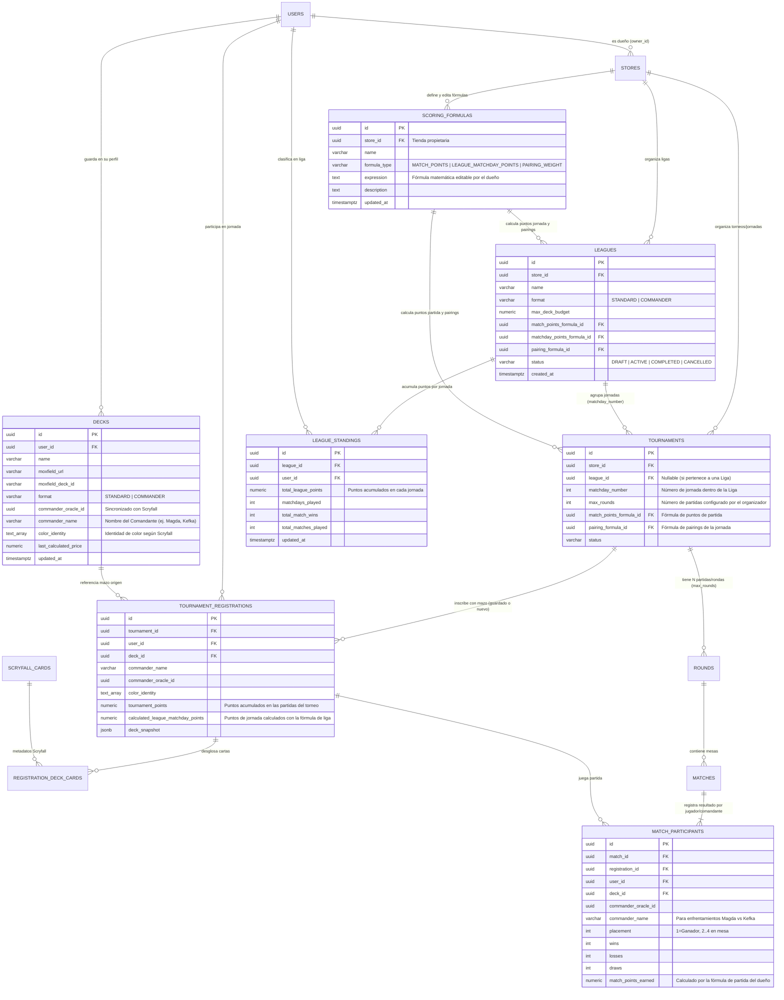

# Data Model: Lógica de Negocio (Usuarios, Mazos en Perfil + Scryfall, Torneos, Ligas, Fórmulas en BD y Estadísticas)

**Feature**: `002-tournament-league-logic`  
**Database Engine**: PostgreSQL 15+ (Supabase / Neon)  
**Migration Strategy**: Extiende `V1__init_store_tournament_schema.sql` mediante `V2__league_formulas_and_business_logic_schema.sql`

---

## 1. Diagrama Entidad-Relación Completo (ER)

---

## 2. Nuevas Tablas y Ampliaciones para la Lógica de Negocio

### 2.1. `scoring_formulas` (Fórmulas Matemáticas Guardadas en Base de Datos por el Dueño)
Responde al cambio de diseño solicitado para que las fórmulas matemáticas (puntos de partida, puntos de jornada de liga y *pairings*) residan en la base de datos y puedan ser modificadas por el dueño de la tienda (`store.owner_id`).

| Columna | Tipo PostgreSQL | Restricciones | Descripción |
| :--- | :--- | :--- | :--- |
| `id` | `UUID` | `PRIMARY KEY DEFAULT gen_random_uuid()` | Identificador de la fórmula matemática. |
| `store_id` | `UUID` | `NOT NULL REFERENCES stores(id) ON DELETE CASCADE` | Tienda cuyo dueño administra la fórmula. |
| `name` | `VARCHAR(120)` | `NOT NULL` | Nombre descriptivo de la fórmula en la tienda. |
| `formula_type` | `VARCHAR(35)` | `NOT NULL CHECK (formula_type IN ('MATCH_POINTS', 'LEAGUE_MATCHDAY_POINTS', 'PAIRING_WEIGHT'))` | Propósito de la fórmula matemática. |
| `expression` | `TEXT` | `NOT NULL` | Expresión matemática editable por el dueño de la tienda. |
| `description` | `TEXT` | `NULL` | Notas o explicación de las reglas aplicadas. |
| `updated_at` | `TIMESTAMPTZ` | `NOT NULL DEFAULT now()` | Fecha de última modificación por el dueño. |

### 2.2. `leagues` (Ligas) y `league_standings` (Puntos Acumulados por Jornada)
Permite registrar una Liga en una tienda, vincular sus funciones matemáticas en base de datos y llevar la clasificación progresiva conforme se disputan las jornadas.

| Tabla | Columna | Tipo PostgreSQL | Restricciones | Descripción |
| :--- | :--- | :--- | :--- | :--- |
| `leagues` | `id` | `UUID` | `PRIMARY KEY DEFAULT gen_random_uuid()` | Identificador de la liga. |
| `leagues` | `store_id` | `UUID` | `NOT NULL REFERENCES stores(id) ON DELETE CASCADE` | Tienda organizadora. |
| `leagues` | `name` | `VARCHAR(150)` | `NOT NULL` | Nombre de la liga. |
| `leagues` | `format` | `VARCHAR(30)` | `NOT NULL CHECK (format IN ('STANDARD', 'COMMANDER'))` | Formato oficial de la liga. |
| `leagues` | `max_deck_budget` | `NUMERIC(10,2)` | `NOT NULL CHECK (max_deck_budget > 0)` | Presupuesto máximo por mazo por defecto en las jornadas. |
| `leagues` | `match_points_formula_id` | `UUID` | `NOT NULL REFERENCES scoring_formulas(id)` | Fórmula por defecto para puntos de cada partida. |
| `leagues` | `matchday_points_formula_id` | `UUID` | `NOT NULL REFERENCES scoring_formulas(id)` | Fórmula para calcular los puntos en cada jornada de liga. |
| `leagues` | `pairing_formula_id` | `UUID` | `NOT NULL REFERENCES scoring_formulas(id)` | Fórmula para calcular los *pairings* en cada jornada. |
| `leagues` | `status` | `VARCHAR(25)` | `NOT NULL DEFAULT 'ACTIVE'` | `DRAFT`, `ACTIVE`, `COMPLETED`, `CANCELLED`. |
| `league_standings` | `league_id` | `UUID` | `NOT NULL REFERENCES leagues(id) ON DELETE CASCADE` | Liga a la que pertenece la clasificación. |
| `league_standings` | `user_id` | `UUID` | `NOT NULL REFERENCES users(id) ON DELETE CASCADE` | Jugador (`UNIQUE (league_id, user_id)`). |
| `league_standings` | `total_league_points` | `NUMERIC(10,2)` | `NOT NULL DEFAULT 0.00` | Suma acumulada de puntos de todas las jornadas jugadas. |
| `league_standings` | `matchdays_played` | `INT` | `NOT NULL DEFAULT 0` | Número de jornadas disputadas por el jugador. |
| `league_standings` | `total_match_wins` | `INT` | `NOT NULL DEFAULT 0` | Victorias totales en partidas dentro de la liga. |
| `league_standings` | `total_matches_played` | `INT` | `NOT NULL DEFAULT 0` | Partidas totales disputadas en la liga. |

### 2.3. Ampliación de `decks` (Perfil del Jugador conectado con Scryfall) y `tournaments` (Jornadas y Fórmulas)
- En **`decks`** (mazos guardados en el perfil del usuario):
  - `format VARCHAR(30)`: Formato del mazo (`STANDARD` o `COMMANDER`).
  - `commander_oracle_id UUID` y `commander_name VARCHAR(200)`: Comandante principal detectado vía Scryfall (ej. `"Magda, Brazen Outlaw"`, `"Kefka, Court Mage"`).
  - `color_identity TEXT[]`: Identidad de color del mazo calculada con Scryfall (`{'R'}`, `{'U','B','R'}`, etc.).
  - `last_calculated_price NUMERIC(10,2)`: Último coste calculado con precios de Scryfall.
- En **`tournaments`** (Torneo individual o Jornada de Liga):
  - `league_id UUID NULL REFERENCES leagues(id) ON DELETE SET NULL`: Vincula el torneo como una jornada de una liga.
  - `matchday_number INT NULL`: Número de jornada dentro de la liga (`UNIQUE (league_id, matchday_number)`).
  - `max_rounds INT NOT NULL`: **Cantidad de partidas por torneo** establecida por el organizador (`FR-005`).
  - `match_points_formula_id UUID REFERENCES scoring_formulas(id)`: Función matemática para calcular los puntos en cada partida del torneo (`FR-007`).
  - `pairing_formula_id UUID REFERENCES scoring_formulas(id)`: Función matemática para calcular los *pairings* en la jornada (`FR-009`).

### 2.4. `match_participants` (Resultados de Partida, Puntos Calculados y Cruces de Comandantes)
Permite registrar cada participante de una partida (duelos de 2 jugadores o mesas Commander de 3-4 jugadores), los puntos que le otorga la función matemática de partida del dueño y el comandante utilizado para calcular las estadísticas de enfrentamientos (*"Magda vs Kefka gana Kefka 60%"*) y de *"Tu Mazo"*.

| Columna | Tipo PostgreSQL | Restricciones | Descripción |
| :--- | :--- | :--- | :--- |
| `id` | `UUID` | `PRIMARY KEY DEFAULT gen_random_uuid()` | Identificador del registro de participación en la partida. |
| `match_id` | `UUID` | `NOT NULL REFERENCES matches(id) ON DELETE CASCADE` | Partida disputada (`UNIQUE (match_id, user_id)`). |
| `registration_id` | `UUID` | `NOT NULL REFERENCES tournament_registrations(id) ON DELETE CASCADE` | Inscripción del jugador en esa jornada (con su snapshot). |
| `user_id` | `UUID` | `NOT NULL REFERENCES users(id)` | Jugador participante. |
| `deck_id` | `UUID` | `NOT NULL REFERENCES decks(id)` | Referencia al mazo del jugador (para agregar estadísticas de *"Tu Mazo"*). |
| `commander_oracle_id` | `UUID` | `NULL` | ID Oracle en Scryfall del comandante jugado. |
| `commander_name` | `VARCHAR(200)` | `NOT NULL` | Nombre del comandante o arquetipo jugado en la partida. |
| `placement` | `INT` | `NOT NULL DEFAULT 1 CHECK (placement >= 1)` | Puesto en la partida (`1` para el ganador). |
| `wins` | `INT` | `NOT NULL DEFAULT 0` | Juegos ganados en la ronda. |
| `losses` | `INT` | `NOT NULL DEFAULT 0` | Juegos perdidos en la ronda. |
| `draws` | `INT` | `NOT NULL DEFAULT 0` | Juegos empatados. |
| `kills` | `INT` | `NOT NULL DEFAULT 0` | Eliminaciones logradas en la mesa (opcional para fórmulas de Commander). |
| `match_points_earned` | `NUMERIC(10,2)` | `NOT NULL DEFAULT 0.00` | Puntos obtenidos tras evaluar la fórmula matemática de partida. |

---

## 3. Consultas Analíticas Soportadas por el Modelo (`FR-011` y `FR-012`)

1. **Cartas más jugadas en la jornada / liga**:
   - Cruza `registration_deck_cards` + `scryfall_cards` + `tournament_registrations` filtrando por `tournament_id` (o `league_id`), agrupando por `scryfall_cards.oracle_id` y `scryfall_cards.name`.
2. **Colores más jugados**:
   - Desglosa `unnest(color_identity)` en `tournament_registrations` y `unnest(colors)` en `scryfall_cards` para obtener el porcentaje exacto de presencia de Blanco (`W`), Azul (`U`), Negro (`B`), Rojo (`R`) y Verde (`G`), así como las combinaciones de identidad de color más frecuentes.
3. **Comandantes más ganadores**:
   - Agrupa `match_participants` por `(commander_oracle_id, commander_name)`, calculando `COUNT(*) AS games_played`, `SUM(CASE WHEN placement = 1 OR wins > losses THEN 1 ELSE 0 END) AS wins`, ratio de victorias (`win_rate`) y media de `match_points_earned`.
4. **Emparejamientos directos de rivales (*Matchups*, ej. "Magda vs Kefka: gana Kefka 60%")**:
   - Realiza un *self-join* sobre `match_participants mp1 JOIN match_participants mp2 ON mp1.match_id = mp2.match_id AND mp1.user_id <> mp2.user_id` en partidas con estado `CONFIRMED`, agrupando por `(mp1.commander_name, mp2.commander_name)` y calculando el porcentaje de veces que `mp2` superó a `mp1` (`mp2.placement < mp1.placement` o `mp2.wins > mp1.wins`).
5. **Estadísticas de *"Tu Mazo"* (`FR-012`)**:
   - Filtra `match_participants` y `tournament_registrations` por `user_id = currentUser.id` y `deck_id = :deckId` (opcionalmente acotado por `tournament_id` o `league_id`), devolviendo:
     - Win rate y puntos medios por partida y por jornada.
     - Historial de enfrentamientos de tu mazo contra cada comandante rival (`mp2.commander_name`) con su porcentaje de victoria/derrota.
     - Distribución de curva de maná (`cmc`), colores y tipos de cartas de tu mazo vía `scryfall_cards` comparada con el promedio de la jornada.
